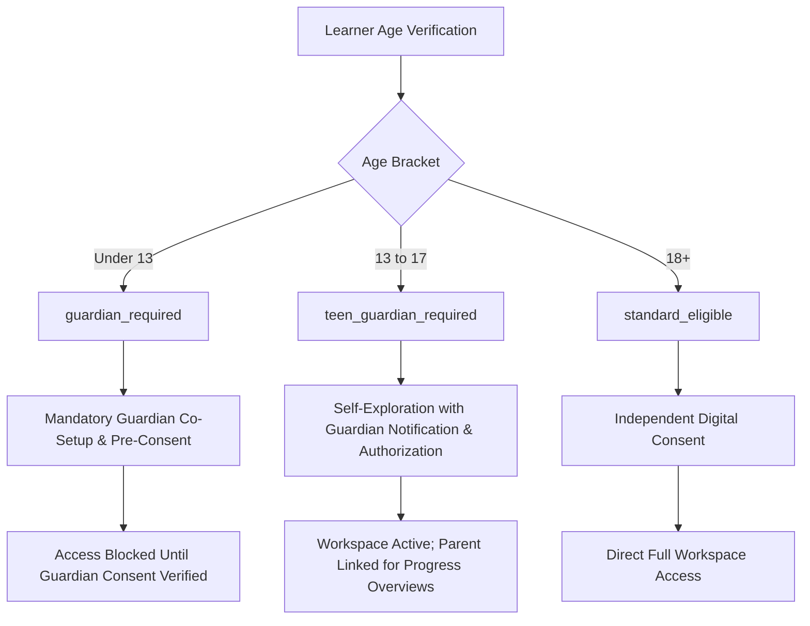
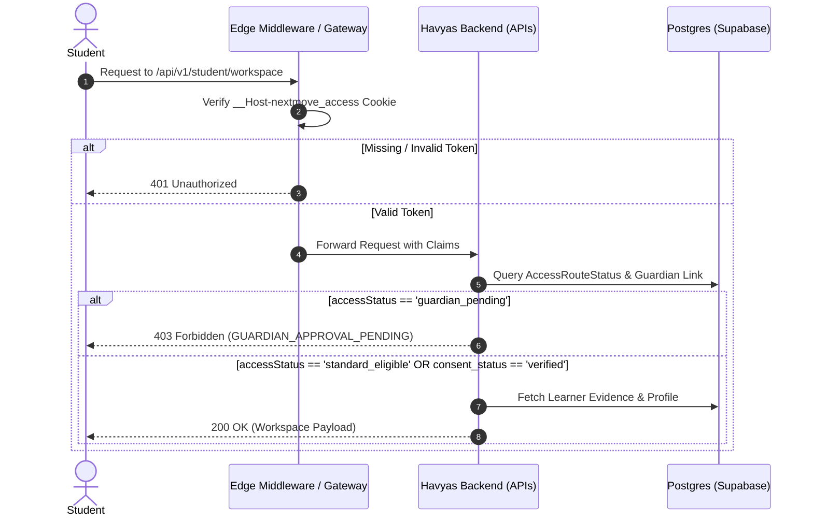

# NEXT MOVE AI V2 — BACKEND INTEGRATION HANDOFF SPECIFICATION

> **DOCUMENT CLASSIFICATION:** Proposed Architecture & Interface Contract  
> **CURRENT STATUS:** `DRAFT — PROPOSED CONTRACT AWAITING FORMAL REVIEW AND SIGN-OFF BY HAVYAS M.P. (BACKEND OWNER)`  
> **FRONTEND RELEASE CANDIDATE:** `release/frontend-rc1` (Next.js 16.4.6, React 19, TypeScript 5)  
> **TARGET BACKEND LEAD:** **Havyas M.P. (Backend Engineering Lead)**  
> **FRONTEND ARCHITECT & RELEASE ENGINEER:** Antigravity (Google DeepMind Agent) / Founder  
> **DATE:** November 18, 2026  
> **CORE GUIDANCE PRINCIPLE:** *"We do not decide careers; we enable clarity."*

---

## 1. Executive Summary & Boundary Definition

This document establishes the authoritative, strongly-typed integration boundary between the Next Move AI V2 Next.js frontend application (`release/frontend-rc1`) and the production backend infrastructure owned by Havyas M.P.

In the frontend release candidate:
- **Public Marketing Pages** (`/`, `/school`, `/college`, `/professionals`) are completely stateless and expose no live account generation.
- **Next.js 16 Proxy Architecture (`src/proxy.ts`):** Replaces deprecated `middleware.ts` conventions with Next.js 16's official proxy pattern. Enforces a **fail-closed security policy**: in production, any missing, empty, or misspelled `DEPLOYMENT_MODE` fails closed to public marketing preview mode, intercepting prototype routes with HTTP 307 redirects before any client bundle or state is served. Only explicitly authorized demo mode (`DEPLOYMENT_MODE=demo`) unlocks prototype routes for controlled evaluations.
- **Demonstration Workspaces** (`/dashboard/student/*`, `/dashboard/parent`, `/onboarding`) utilize window-session-scoped `sessionStorage` mock adapters solely for controlled institutional evaluation and automated Playwright regression testing.
- **Production Integration Requirement:** Real visitor authentication, encrypted credential storage, verifiable parental consent under the Digital Personal Data Protection (DPDP) Act, and persistent student evidence logging must be implemented by Havyas M.P. against this contract.

---

## 2. Authentication & Session Hygiene (HTTP-Only Cookies)

### 2.1 Rejection of Client-Side Storage for Sensitive Credentials & Storage Lifecycle Realities
The frontend strictly prohibits storing JWT access tokens, refresh tokens, passwords, or session secrets in `localStorage` or `sessionStorage`. Storing bearer tokens in web storage exposes learners to cross-site scripting (XSS) credential exfiltration.

#### Technical Storage Lifecycle Audit:
1. **No "RAM-Only" Guarantee:** `sessionStorage` is not volatile memory (RAM-only). Browser engines (Blink/Chromium, WebKit, Gecko) persist `sessionStorage` to disk-backed SQLite/LevelDB caches during active browser sessions.
2. **Persistence Across Page Reloads:** `sessionStorage` survives intentional or accidental page reloads (`F5` / `Ctrl+R`) and internal single-page navigation.
3. **Cloning on Tab Duplication:** When a browser tab is duplicated (via browser context menu, `Ctrl+T` duplicate, or script-initiated window clone), the browser engine creates an exact clone of the parent tab's `sessionStorage` in the new tab.
4. **Restoration on Session Recovery:** When a browser crashes, or when a user closes and restores a tab (`Ctrl+Shift+T`), or restarts a browser with *"On startup: Open where you left off"*, modern browsers restore the entire `sessionStorage` state.
5. **Shared Device / Kiosk Risks:** On shared institutional workstations, if a student leaves a browser window open, subsequent users have access to that tab's `sessionStorage` unless an explicit manual sign-out / reset (`sessionStorage.clear()`) is performed.

Because of these realities, Next Move AI's frontend uses `sessionStorage` exclusively for transient, synthetic mock fixtures. Production authentication must never use browser storage and must rely entirely on the HTTP-only cookie architecture below.

### 2.2 Dual-Cookie Partitioned Session Model
The production backend must implement an enterprise-grade dual-cookie authentication scheme over HTTPS/TLS:

| Cookie Name | Purpose | Scope | HttpOnly | SameSite | Secure | Lifetime |
|---|---|---|---|---|---|---|
| `__Host-nextmove_access` | Short-lived API authorization | `/api/` | `true` | `Lax` | `true` | 15 minutes |
| `__Host-nextmove_refresh` | Silent session renewal token | `/api/v1/auth/refresh` | `true` | `Strict` | `true` | 7–30 days |

### 2.3 Authentication Endpoints Specification

#### A. Sign In
- **Method / Path:** `POST /api/v1/auth/sign-in`
- **Request Body:**
```json
{
  "email": "student@example.com",
  "password": "ClearTextPasswordSentOverTLS"
}
```
*(Note: Client does not execute client-side SHA hashing; standard plaintext-over-TLS ensures the backend hashes via Argon2id or bcrypt with per-user salt.)*

- **Response Headers:**
```http
HTTP/1.1 200 OK
Set-Cookie: __Host-nextmove_access=eyJhbGciOi...; Path=/api/; Secure; HttpOnly; SameSite=Lax; Max-Age=900
Set-Cookie: __Host-nextmove_refresh=def5020...; Path=/api/v1/auth/refresh; Secure; HttpOnly; SameSite=Strict; Max-Age=2592000
```
- **Response Body (`200 OK`):**
```json
{
  "user": {
    "id": "usr_9b1deb4d3b7d4",
    "email": "student@example.com",
    "displayName": "Rhea Sharma",
    "role": "student",
    "academicStage": "classes-11-12",
    "emailVerified": true,
    "accessStatus": "standard_eligible"
  },
  "destination": "dashboard"
}
```

#### B. Silent Session Refresh
- **Method / Path:** `POST /api/v1/auth/refresh`
- **Headers Required:** Automatically transmits `__Host-nextmove_refresh` cookie.
- **Behavior:** Rotates refresh token (detects reuse/theft); issues new `__Host-nextmove_access`.

#### C. Session Status Check
- **Method / Path:** `GET /api/v1/auth/session`
- **Response Body (`200 OK`):**
```json
{
  "authenticated": true,
  "user": {
    "id": "usr_9b1deb4d3b7d4",
    "email": "student@example.com",
    "displayName": "Rhea Sharma",
    "role": "student",
    "academicStage": "classes-11-12",
    "emailVerified": true,
    "accessStatus": "standard_eligible"
  }
}
```
- **Response Body (`401 Unauthorized`):**
```json
{
  "authenticated": false
}
```

#### D. Sign Out
- **Method / Path:** `POST /api/v1/auth/sign-out`
- **Behavior:** Invalidates server-side session in database/Redis; instructs browser to expire both cookies (`Max-Age=0`).

---

## 3. Guardian-Student Authorization (`GuardianStudentLink`) & DPDP Compliance

### 3.1 Legal Foundation & Statutory Schedule
In compliance with the **Digital Personal Data Protection (DPDP) Act 2023 (India)**, Section 9 (Processing of personal data of children), whose statutory commencement is scheduled for **May 13, 2027** pursuant to notification **G.S.R. 843(E)** dated **November 13, 2025**, the platform enforces verifiable parental consent for minor learners.

### 3.2 Age Stratification & Access Routing
The frontend routes incoming learners into three strict categories via `AccessRouteStatus`:



### 3.3 Database Entity: `guardian_student_link`
The backend must maintain an immutable relational link and consent audit log:

```sql
CREATE TABLE guardian_student_link (
    id UUID PRIMARY KEY DEFAULT gen_random_uuid(),
    student_id UUID NOT NULL REFERENCES users(id) ON DELETE CASCADE,
    guardian_id UUID REFERENCES users(id) ON DELETE SET NULL,
    guardian_email VARCHAR(255) NOT NULL,
    relationship VARCHAR(50) NOT NULL CHECK (relationship IN ('parent', 'legal_guardian', 'educator_sponsor', 'mentor_advisor')),
    consent_status VARCHAR(50) NOT NULL DEFAULT 'pending' CHECK (consent_status IN ('pending', 'verified', 'rejected', 'revoked')),
    verification_method VARCHAR(50) CHECK (verification_method IN ('email_magic_link', 'sms_otp', 'digilocker_aadhaar', 'school_institutional_roster')),
    consent_timestamp TIMESTAMPTZ,
    consent_ip_hash VARCHAR(64),
    consent_terms_version VARCHAR(20) NOT NULL,
    permissions JSONB DEFAULT '{"allow_partner_chat": true, "allow_project_logging": true, "weekly_summary_email": true}'::jsonb,
    created_at TIMESTAMPTZ DEFAULT NOW(),
    updated_at TIMESTAMPTZ DEFAULT NOW()
);

CREATE INDEX idx_guardian_student_student_id ON guardian_student_link(student_id);
CREATE INDEX idx_guardian_student_guardian_id ON guardian_student_link(guardian_id);
```

### 3.4 Guardian Authorization Status Endpoint
- **Method / Path:** `GET /api/v1/guardian/authorization-status?studentId={studentId}`
- **Response (`200 OK`):**
```json
{
  "studentId": "usr_9b1deb4d3b7d4",
  "status": "approved",
  "guardianEmailMasked": "s.s*****a@example.com",
  "relationship": "parent",
  "invitedAt": "2026-11-16T08:30:00Z",
  "verifiedAt": "2026-11-16T09:15:00Z"
}
```

---

## 4. Academic Stage Slugs & Matrix Alignment

The frontend architecture is partitioned into six canonical academic cohorts. The backend must enforce consistent slug normalization across APIs and database schemas:

| Canonical URL Slug | Database Enum Value | Academic Cohort Title | Age / Stage Range | Primary Pedagogy Focus |
|---|---|---|---|---|
| `classes-4-7` | `classes_4_7` | Middle School | Classes 4–7 | Curiosity sparks, playful micro-activities, family prompts |
| `classes-8-10` | `classes_8_10` | High School | Classes 8–10 | Foundational subject discovery, low-stakes trials, no premature locking |
| `classes-11-12` | `classes_11_12` | Pre-University / Senior Secondary | Classes 11–12 | Academic stream exploration (Science, Commerce, Arts), practical clarity |
| `diploma` | `diploma` | Polytechnic & Applied Technical | 3-Year Diploma | Hands-on technical skills, industry application blueprints, career bridges |
| `degree-engineering` | `degree_engineering` | Undergraduate Higher Education | B.Tech / B.E. / Degree | Project prototypes, multidisciplinary trials, industry readiness |
| `final-year-grad` | `final_year_grad` | Career Launch & Post-Graduation | Final Year / Early Career | Capstone evidence, transition reality checks, professional portfolio |

### 4.1 Neutral Academic Stage Selection & Missing Context Handling
In accordance with pedagogical integrity invariants, when an incoming request to authenticated registration, onboarding (`/onboarding`), or profile setup lacks an established academic stage context or contains an invalid identifier:
- **Zero Silent Defaulting:** The system **MUST NEVER silently default or pre-select Class 12 (`classes-11-12`) or any other stage**. Silent defaulting distorts student evidence, biases recommendations, and masks navigation defects.
- **Explicit User Stage Selection Required:** The system must actively present the neutral 6-stage selection screen (*"Select your academic stage to begin"*), requiring the student to explicitly choose their current cohort before proceeding, as verified by `e2e/stage-fallback.spec.ts` (`STAGE.1` and `STAGE.2`).
- **Anonymous Marketing Demonstrations:** Only in completely unauthenticated public marketing previews where no learner record or session is being created may the UI display a neutral reference sample for demonstrative illustration.

---

## 5. Degree Context & Specialization Models

For undergraduate and diploma cohorts (`degree-engineering` and `diploma`), the backend student profile must support extended academic context without over-constraining career recommendations:

```typescript
export interface DegreeContextPayload {
  degreeType: "B.Tech" | "B.E." | "B.Sc" | "B.Com" | "B.A." | "BBA" | "BCA" | "Diploma" | "Other";
  specializationBranch?: string; // e.g. "Computer Science & Engineering", "Mechanical", "Biotechnology"
  currentSemesterYear: number;   // 1 through 8
  institutionType?: "Tier_1_Central" | "State_University" | "Autonomous" | "Affiliated_Private";
  primaryInterests: string[];     // Up to 5 interest domain slugs
}
```

---

## 6. Exploration Situations: Discover / Begin / Progress

Students engage with Next Move AI through three dynamic postures rather than rigid linear funnels:

1. **`DISCOVER`**:
   - **User Context:** Open-minded curiosity; uncommitted to any single path.
   - **Frontend View:** Stage Explorer, Spark Cards, Interest domain browsing.
   - **Backend Requirement:** Deliver diverse, low-stakes micro-challenges (5–10 minutes) across contrasting domains (e.g. Tech vs. Design vs. Biology).

2. **`BEGIN`**:
   - **User Context:** Ready to test a specific concept through hands-on work.
   - **Frontend View:** Projects workspace, Step-by-step trial blueprints.
   - **Backend Requirement:** Provide structured project blueprints with clear milestones, estimated completion times, and initial reflection prompts.

3. **`PROGRESS`**:
   - **User Context:** Deepening exploration; accumulating trial reflections and seeking synthesis.
   - **Frontend View:** Growth workspace, Evidence Log, My Partner reflection chat.
   - **Backend Requirement:** Aggregate completed reflections, highlight emerging patterns, and suggest natural adjacent directions.

---

## 7. Evidence Taxonomy & Rejection of Pseudoscientific Fit Scores

### 7.1 Firm Rejection of "Career Suitability Percentages"
The Next Move AI product ethos categorically rejects pseudoscientific "Fit Scores" (e.g. *"You are 87% suited to Data Science"*). Such scores create artificial anxiety, encourage premature career locking, and lack pedagogical validity.

### 7.2 The 4-Tier Objective Evidence Taxonomy
Student progression is measured exclusively through demonstrable evidence records categorized into four objective types:

```typescript
export type EvidenceType =
  | "OBSERVATION"  // Self-noted engagement: "Felt high focus when analyzing datasets"
  | "CREATION"     // Tangible artifact: GitHub repo, Figma prototype, written essay
  | "REFLECTION"   // Structured self-appraisal: Energy level, difficulty rating, key takeaway
  | "VALIDATION";  // External checkpoint: Mentor review, lab demonstration, completed trial
```

### 7.3 Evidence Record Schema
```sql
CREATE TABLE student_evidence_records (
    id UUID PRIMARY KEY DEFAULT gen_random_uuid(),
    student_id UUID NOT NULL REFERENCES users(id) ON DELETE CASCADE,
    stage_id VARCHAR(50) NOT NULL,
    interest_domain VARCHAR(100) NOT NULL,
    title VARCHAR(255) NOT NULL,
    evidence_type VARCHAR(50) NOT NULL CHECK (evidence_type IN ('OBSERVATION', 'CREATION', 'REFLECTION', 'VALIDATION')),
    artifact_url TEXT,
    reflection_notes TEXT NOT NULL,
    energy_level VARCHAR(20) CHECK (energy_level IN ('high', 'medium', 'low', 'draining')),
    difficulty_rating VARCHAR(20) CHECK (difficulty_rating IN ('breeze', 'stimulating', 'overwhelming')),
    created_at TIMESTAMPTZ DEFAULT NOW(),
    updated_at TIMESTAMPTZ DEFAULT NOW()
);
```

---

## 8. My Partner AI — SSE Streaming & Conversational Safety

### 8.1 Server-Sent Events (SSE) Streaming Protocol
Conversations with "My Partner" must stream via SSE over HTTP/2 or HTTP/1.1 chunked transfer to provide low-latency feedback.

- **Endpoint:** `POST /api/v1/partner/chat/stream`
- **Headers:** `Accept: text/event-stream`, `Content-Type: application/json`
- **Request Body:**
```json
{
  "conversationId": "conv_4f8a2b10",
  "message": "I enjoy coding but also like writing stories. How can I combine both?",
  "studentContext": {
    "academicStage": "classes-11-12",
    "recentEvidenceSummary": ["Built basic interactive python game", "Writes short fiction"]
  }
}
```

- **SSE Stream Protocol Format:**
```http
event: token
data: {"chunk": "That's "}

event: token
data: {"chunk": "a wonderful "}

event: token
data: {"chunk": "combination! "}

event: suggestions
data: {"chips": ["Explore Narrative Game Design", "Try Interactive Fiction Writing", "Look at Technical Writing"]}

event: done
data: {"conversationId": "conv_4f8a2b10", "totalTokens": 142, "safe": true}
```

### 8.2 Strict LLM Safety Guardrails & Principles
The backend LLM orchestrator (Gemini / Claude / local model) must enforce system prompts containing the following non-negotiable rules:
1. **No Psychological or Psychiatric Diagnosis:** Under no circumstance may the system claim or imply assessment of psychological conditions, learning disabilities, or personality disorders.
2. **No Career Dictation:** Never say *"You should become a..."* or *"You are best suited for..."*. Always frame responses as possibilities: *"You might enjoy exploring..."* or *"One hands-on way to test this is..."*.
3. **Minor Safeguards & Immediate Escalation:** If incoming queries indicate personal distress, depression, self-harm, or child safety violations, the model must immediately break character and output pre-approved institutional support resources and national helplines.

---

## 9. Consent Enforcement & Edge Gateway Filtering



---

## 10. Phased Backend Delivery Schedule for Havyas M.P.

| Sprint / Milestone | Backend Scope | Target Deliverable | Frontend Dependency |
|---|---|---|---|
| **Phase B1: Auth & Cookies** | `POST /api/v1/auth/sign-in`, `POST /api/v1/auth/refresh`, `GET /api/v1/auth/session` | HTTP-only cookie exchange, session invalidation | Replaces frontend mock auth adapter |
| **Phase B2: DPDP & Guardian Link** | `guardian_student_link` table, consent email magic links, status checks | Verifiable Parental Consent pipeline | Unlocks live `/verify` and teen onboarding |
| **Phase B3: Student Profile & Stages** | PostgreSQL schemas for student profiles, 6-stage metadata | Dynamic stage curriculum resolution | Powers student home dashboard |
| **Phase B4: Evidence Store** | `student_evidence_records` table, CRUD APIs | Persistence of observations, trials, reflections | Replaces browser `sessionStorage` in Validate Fit |
| **Phase B5: My Partner Streaming** | SSE streaming endpoint (`/api/v1/partner/chat/stream`) with safety system prompt | Low-latency conversational guidance | Replaces deterministic partner script |

---

## 11. Contract Review & Sign-Off Register

| Role | Name | Organization | Status | Date |
|---|---|---|---|---|
| Frontend Lead & Architect | Antigravity / Founder | Navlore AI Technologies LLP | **SUBMITTED FOR REVIEW** | Nov 18, 2026 |
| Backend Engineering Lead | **Havyas M.P.** | Navlore AI Technologies LLP | **DRAFT — PENDING FORMAL REVIEW** | Awaiting Review |
| Release Manager | Independent QA Lead | Navlore AI Technologies LLP | **APPROVED AS FRONTEND RC CONTRACT** | Nov 18, 2026 |
