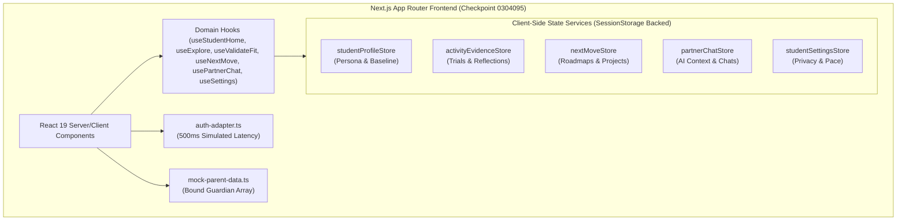
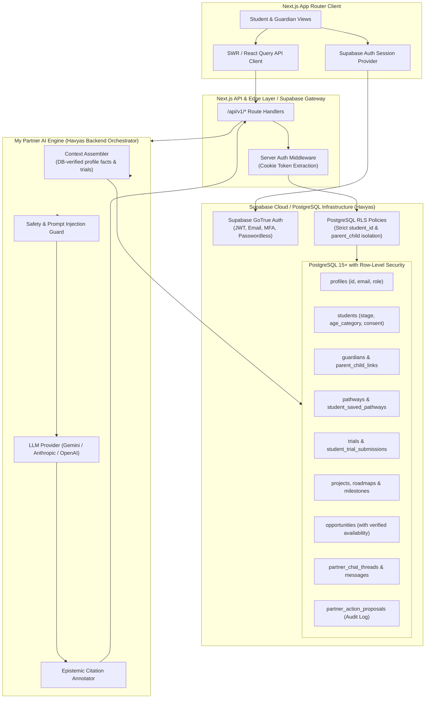
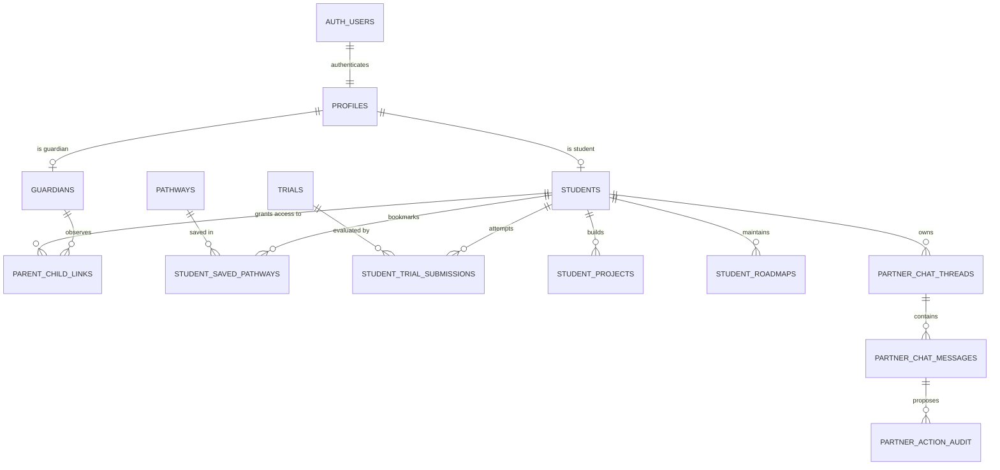
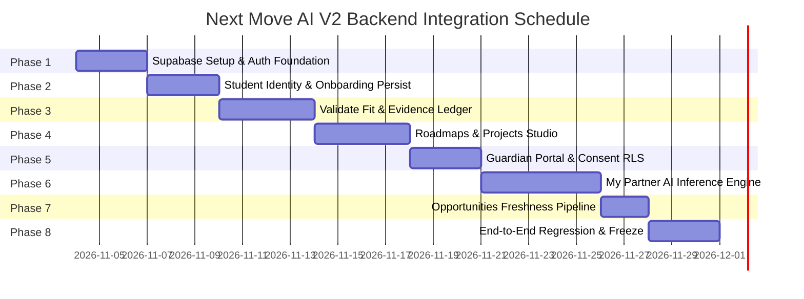

# NEXT MOVE AI V2 — Master Frontend Architecture & Backend Integration Handoff

**Product:** Next Move AI V2 (Student Intelligence, Career Decision & Continuous Growth Platform)  
**Organization:** Navlore AI Technologies LLP  
**Document Classification:** Authoritative Technical Specification & Backend Integration Contract  
**Document Location:** `docs/NEXT_MOVE_AI_V2_MASTER_BACKEND_HANDOFF_HAVYAS.md`  
**Frontend Owner:** Founder — Google Antigravity / Next.js Lead  
**Backend Owner:** **Havyas M.P — Lead Developer Intern / Backend Engineering Lead**  
**Final Frontend Baseline Checkpoint:** `0304095`  
**Date:** November 3, 2026  
**Core Product Philosophy:** *"We don't decide careers; we enable clarity."*

---

## Document Status & Verification Legend

Every architectural component, data structure, and endpoint specification in this handoff document is classified using the following strict labels:

- **`[IMPLEMENTED IN FRONTEND]`**: Code, UI views, state stores, and client validations are 100% written, source-verified, and regression-tested in checkpoint `0304095`.
- **`[BACKEND REQUIRED]`**: Essential production backend capability that Havyas must implement (database tables, authentication handlers, RLS policies, or LLM orchestrators).
- **`[PROPOSED — APPROVAL REQUIRED]`**: Architectural pattern, schema design, or API signature proposed by the frontend team that requires review and formal sign-off by Havyas before implementation.
- **`[DEFERRED]`**: Post-V2 capability scheduled for future iterations (e.g. Flow 10 Community & Peer Circles).

---

## Table of Contents
1. [Frontend Baseline & Environment Specification](#1-frontend-baseline--environment-specification)
2. [Complete System Architecture](#2-complete-system-architecture)
3. [Frontend Route and Module Inventory](#3-frontend-route-and-module-inventory)
4. [Authoritative Data Model Inventory](#4-authoritative-data-model-inventory)
5. [Database Architecture for Havyas (Supabase PostgreSQL)](#5-database-architecture-for-havyas-supabase-postgresql)
6. [Complete API Contract Specification](#6-complete-api-contract-specification)
7. [Authentication and Authorization Architecture](#7-authentication-and-authorization-architecture)
8. [My Partner — AI Backend Architecture](#8-my-partner--ai-backend-architecture)
9. [Evidence Integrity and Student Growth Engine](#9-evidence-integrity-and-student-growth-engine)
10. [Opportunities and Eligibility Management](#10-opportunities-and-eligibility-management)
11. [Student Privacy, Security and DPDP Compliance](#11-student-privacy-security-and-dpdp-compliance)
12. [Complete Mock-to-Backend Replacement Matrix](#12-complete-mock-to-backend-replacement-matrix)
13. [Phased Integration Implementation Plan for Havyas](#13-phased-integration-implementation-plan-for-havyas)
14. [Verification and Acceptance Requirements](#14-verification-and-acceptance-requirements)
15. [Implementation Ownership and Decision Register](#15-implementation-ownership-and-decision-register)

---

## 1. Frontend Baseline & Environment Specification `[IMPLEMENTED IN FRONTEND]`

### 1.1 Source Baseline Verification
- **Current Git HEAD:** Commit `0304095` (`feat: complete student settings, parent dashboard, and global error boundaries`).
- **Linear Lineage:** `14baa68` (Flow 7) &rarr; `0f9f360` (Flow 7.1 Status Accuracy) &rarr; `2c2a055` (Flow 8 My Partner) &rarr; `0304095` (Final Complete Frontend).
- **Working Tree:** 100% clean, 0 untracked files, 0 merge conflicts.

### 1.2 Technology Stack Versions (from `package.json`)
```json
{
  "dependencies": {
    "next": "16.4.3",
    "react": "19.3.0",
    "react-dom": "19.3.0",
    "lucide-react": "^1.61.0",
    "clsx": "^2.1.1",
    "tailwind-merge": "^3.7.0"
  },
  "devDependencies": {
    "typescript": "^5",
    "tailwindcss": "^4",
    "@tailwindcss/turbopack": "^4",
    "eslint": "^9",
    "eslint-config-next": "16.4.3",
    "@playwright/test": "^1.64.1",
    "@axe-core/playwright": "^4.14.0",
    "@types/node": "^20",
    "@types/react": "^19",
    "@types/react-dom": "^19"
  }
}
```

### 1.3 Execution Commands for Backend Developers
- **Local Dev Server:** `npm run dev` (starts Next.js App Router on `http://localhost:3000`).
- **Production Build:** `npm run build` (runs Next.js production compiler; generates 22 static routes).
- **TypeScript Static Audit:** `npx tsc --noEmit` (0 type errors).
- **ESLint Code Quality Audit:** `npx eslint src/` (0 errors, 0 warnings).
- **Playwright Full Regression Test:** `npx playwright test` (executes 148 automated tests across 17 spec files in headless Chromium).

### 1.4 Directory Topology
```
next-move-ai-v2/
├── docs/                           # Technical contracts and handoff specifications
├── e2e/                            # 17 Playwright E2E test suites (148 tests)
├── public/                         # Brand logos and static media
├── src/
│   ├── app/                        # Next.js App Router (22 prerendered routes)
│   │   ├── dashboard/
│   │   │   ├── parent/             # Guardian Observation Portal
│   │   │   └── student/            # Student Workspace (Home, Explore, Growth, Projects, Partner, Settings)
│   │   ├── get-started/            # Role and Stage selection
│   │   ├── onboarding/             # Flow 3 Adaptive Onboarding Wizard
│   │   ├── error.tsx               # Global runtime error boundary
│   │   └── not-found.tsx           # Branded 404 recovery page
│   ├── components/                 # Shared UI shells and auth layouts
│   ├── data/                       # Static landing demos and stage configurations
│   ├── features/                   # Domain-driven feature modules
│   │   ├── build-next-move/        # Flow 7 Roadmaps, Projects & Opportunities
│   │   ├── explore/                # Flow 5 Career Possibilities Matrix
│   │   ├── onboarding/             # Flow 3 Multi-Stage Profiling
│   │   ├── parent-dashboard/       # Guardian Observation & Linked Child Management
│   │   ├── partner/                # Flow 8 Epistemic AI Companion
│   │   ├── settings/               # Student Settings, Privacy & Prototype Export
│   │   ├── student-home/           # Flow 4 Central Student Dashboard
│   │   └── validate-fit/           # Flow 6 Practical Experiential Trials
│   └── lib/                        # Contract definitions, auth adapters, and shared utilities
```

---

## 2. Complete System Architecture

### 2.1 Current Implemented Architecture `[IMPLEMENTED IN FRONTEND]` vs Target Integrated Architecture `[BACKEND REQUIRED]`

#### Current Implemented Architecture (Client-Side Reactive Baseline)


#### Proposed Backend Integrated Architecture (Target State with Supabase) `[PROPOSED — APPROVAL REQUIRED]`


---

## 3. Frontend Route and Module Inventory `[IMPLEMENTED IN FRONTEND]`

The Next Move AI V2 frontend exposes 22 prerendered routes. Every route is verified for responsive rendering (360px–1440px) and WCAG 2.1 AA accessibility:

| Route Path | Source File | Primary Components | State Services / Stores | Auth & Role Required | Target Backend Integration Point |
| :--- | :--- | :--- | :--- | :--- | :--- |
| `/` | `src/app/page.tsx` | `LandingHero`, `StudentExplorer`, `Header`, `Footer` | `landing-demo.ts` | Public (Anonymous) | Dynamic hero content & stage metrics |
| `/_not-found` | `src/app/not-found.tsx` | `NotFound` | None | Public | Static recovery navigation |
| `/get-started` | `src/app/get-started/page.tsx` | `RoleSelection` | None | Public | Query preservation (`?stage=...`) |
| `/get-started/student` | `src/app/get-started/student/page.tsx` | `StudentStageSelection` | `landing-demo.ts` | Public | Stage eligibility check |
| `/get-started/student/access` | `src/app/get-started/student/access/page.tsx` | `StudentAccessContent` | `flow2-config.ts` | Public | Minor digital consent rule validation |
| `/guardian-support` | `src/app/guardian-support/page.tsx` | `GuardianSupportContent` | None | Public | Under-13 guidance & parent registration trigger |
| `/sign-in` | `src/app/sign-in/page.tsx` | `SignInContent` | `auth-adapter.ts` | Public | `POST /api/v1/auth/sign-in` (Supabase Auth) |
| `/sign-up/student` | `src/app/sign-up/student/page.tsx` | `StudentSignUpContent` | `auth-adapter.ts` | Public | `POST /api/v1/auth/register/student` |
| `/sign-up/parent` | `src/app/sign-up/parent/page.tsx` | `ParentSignUpContent` | `auth-adapter.ts` | Public | `POST /api/v1/auth/register/parent` |
| `/forgot-password` | `src/app/forgot-password/page.tsx` | `ForgotPasswordContent` | `auth-adapter.ts` | Public | `POST /api/v1/auth/forgot-password` |
| `/verify` | `src/app/verify/page.tsx` | `VerifyContent` | None | Public | `POST /api/v1/auth/verify-email` |
| `/onboarding` | `src/app/onboarding/page.tsx` | `OnboardingWizard` | `studentProfileStore` | Public / Student | `POST /api/v1/students/me/profile/baseline` |
| `/dashboard/student` | `src/app/dashboard/student/page.tsx` | `WelcomePanel`, `NextMoveCard`, `GrowthSnapshot` | `studentProfileStore`, `nextMoveStore` | Authenticated Student | `GET /api/v1/students/me/dashboard` |
| `/dashboard/student/profile` | `src/app/dashboard/student/profile/page.tsx` | `StudentProfileReview` | `studentProfileStore` | Authenticated Student | `GET /api/v1/students/me/profile` |
| `/dashboard/student/explore` | `src/app/dashboard/student/explore/page.tsx` | `ExplorePossibilitiesWorkspace`, `PathwayDetailModal` | `explore-store.ts` | Authenticated Student | `GET /api/v1/pathways`, `POST /api/v1/pathways/saved` |
| `/dashboard/student/growth` | `src/app/dashboard/student/growth/page.tsx` | `ValidateFitWorkspace`, `TrialRunnerModal` | `activityEvidenceStore` | Authenticated Student | `GET /api/v1/growth/trials`, `POST /api/v1/growth/submissions` |
| `/dashboard/student/projects` | `src/app/dashboard/student/projects/page.tsx` | `NextMoveWorkspace`, `ProjectRunnerModal` | `nextMoveStore` | Authenticated Student | `GET/PATCH /api/v1/projects`, `GET /api/v1/opportunities` |
| `/dashboard/student/partner` | `src/app/dashboard/student/partner/page.tsx` | `PartnerWorkspace`, `ActionConfirmationModal` | `partnerChatStore` | Authenticated Student | `POST /api/v1/partner/chat` (LLM Inference) |
| `/dashboard/student/settings` | `src/app/dashboard/student/settings/page.tsx` | `StudentSettingsWorkspace` | `studentSettingsStore` | Authenticated Student | `PATCH /api/v1/students/me/preferences`, Data Export |
| `/dashboard/parent` | `src/app/dashboard/parent/page.tsx` | `ParentDashboardWorkspace` | `mock-parent-data.ts` | Authenticated Guardian | `GET /api/v1/parent/children`, Consent Management |
| `/error` | `src/app/error.tsx` | `GlobalError` | None | Public | Error tracking & telemetry logging |

---

## 4. Authoritative Data Model Inventory `[IMPLEMENTED IN FRONTEND]`

The frontend codebase defines strict TypeScript interfaces across 10 domain schema files. Havyas must preserve these property names and types in backend JSON payloads:

### 4.1 Academic Stage Identifier
**File:** `src/data/landing-demo.ts`
```typescript
export type AcademicStageId =
  | "classes-4-7"          // Middle School (Exploratory / Curiosity themes)
  | "classes-8-10"         // Secondary School (Foundational streams)
  | "classes-11-12"        // Senior Secondary (PCM, PCB, Commerce, Arts)
  | "diploma"              // Polytechnic & Technical Diplomas
  | "degree-engineering"   // Undergraduate Professional Degrees (B.Tech, BCA, BCom, etc.)
  | "final-year-grad";     // Final Year Students & Recent Graduates
```

### 4.2 Evidence Taxonomy (Canonical 6-Tier Hierarchy)
**Files:** `src/features/onboarding/schemas/types.ts` & `src/features/validate-fit/types.ts`
```typescript
export type EvidenceStatus =
  | "not_assessed"     // Area not yet explored (Never labeled as "weak")
  | "self_reported"    // Stated by student in onboarding without practical evaluation
  | "attempted"        // Began an activity or skipped steps without full reflection
  | "practised"        // Completed an interactive mini-challenge or simulation
  | "reviewed"         // Evaluated against a rubric with peer, mentor, or self-critique
  | "demonstrated";    // Verified against an authentic rubric deliverable (Never auto-awarded)
```

### 4.3 Student Intelligence Profile (Flow 3 Onboarding Baseline)
**File:** `src/features/onboarding/schemas/types.ts`
```typescript
export interface StudentIntelligenceProfile {
  profileId: string;
  academicStageId: AcademicStageId;
  academicContext: AcademicContextData;
  clarity: ClarityData;
  interests: InterestsData;
  startingSkills: SkillItem[];
  activityAttempt?: ActivityAttemptResult;
  reflection: ReflectionData;
  possibilities: StartingPossibility[];
  firstNextMove: FirstNextMoveAction;
  status: "draft" | "student_reviewed" | "confirmed";
  updatedAt: string;
}

export interface InterestsData {
  selectedCategoryIds: string[];
  selectedSubInterestIds: string[];
  customInterestText?: string;
  isStillExploring: boolean;
}
```

### 4.4 Pathway Discovery Model (Flow 5 Explore)
**File:** `src/features/explore/types.ts`
```typescript
export interface Pathway {
  id: string;
  title: string;
  type: "curiosity_theme" | "foundational_stream" | "traditional_degree" | "emerging_frontier" | "practical_lateral" | "exploratory_general";
  categoryId: string;
  categoryLabel: string;
  stageSuitability: AcademicStageId[];
  isCuriosityOnly: boolean; // Enforced true for classes-4-7 (zero job titles)
  headlineSummary: string;
  detailedOverview: string;
  whatPeopleLearnOrDo: string[];
  dayInTheLife: DayInTheLifeBlock[];
  foundationalSkills: FoundationalSkill[];
  educationRoutes: EducationRouteOption[];
  eligibilityAndRealities: {
    prerequisitesText: string;
    tradeoffsToConsider: string[];
    honestDisclaimer: string;
  };
  beforeYouCommitTrial: PreCommitmentTrial;
  whatRemainsUnknown: string;
  alternativePathways: PathwayRelatedAlternative[];
  tags: string[];
}
```

### 4.5 Experiential Trial Attempt & Reflection (Flow 6 Validate Fit)
**File:** `src/features/validate-fit/types.ts`
```typescript
export interface TrialAttemptRecord {
  id: string;
  trialId: string;
  trialTitle: string;
  pathwayId: string;
  stageId: AcademicStageId;
  format: "creative_prompt" | "scenario_tradeoff" | "logic_simulation" | "applied_troubleshoot" | "case_critique";
  status: "in_progress" | "completed" | "skipped";
  evidenceStatus: EvidenceStatus;
  startedAt: string;
  completedAt?: string;
  selectedOptionIds?: string[];
  submittedWorkText?: string;
  reflection?: TrialReflection;
  competencyPractised: string;
  isSyntheticFixture?: boolean;
}

export interface TrialReflection {
  enjoyed: string;
  challenged: string;
  learned: string;
  wouldExploreAgain: "yes" | "maybe" | "not_for_me";
  whatTryDifferently: string;
}
```

### 4.6 Projects & Opportunities Model (Flow 7 Build My Next Move)
**File:** `src/features/build-next-move/types.ts`
```typescript
export interface ActiveProject {
  id: string;
  templateId?: string;
  title: string;
  problemStatement: string;
  stageId: AcademicStageId;
  categoryId: string;
  categoryLabel: string;
  status: "in_progress" | "completed" | "paused";
  steps: ProjectStep[];
  artifacts: ProjectEvidenceArtifact[];
  reflection?: ProjectReflectionData;
  startedAt: string;
  completedAt?: string;
}

export interface ProjectEvidenceArtifact {
  id: string;
  title: string;
  artifactType: "link_github" | "link_figma" | "link_document" | "link_spreadsheet" | "notes_summary" | "image_proof";
  urlOrReference: string;
  description?: string;
  addedAt: string;
}

export interface OpportunityItem {
  id: string;
  title: string;
  organizationName: string;
  opportunityType: "internship" | "scholarship" | "competition" | "fellowship" | "camp_workshop";
  provenance: "verified_listing" | "curated_educational" | "prototype_example";
  stageSuitability: AcademicStageId[];
  locationOrMode: string;
  stipendOrCostDescription: string;
  description: string;
  eligibilityCriteria: {
    minStageRequired: AcademicStageId;
    prerequisites: string[];
    isEligibleCurrently: boolean;
    whyIneligibleReason?: string;
  };
  applicationStatus: "open" | "upcoming" | "closed" | "unknown";
  officialSourceUrl: string;
  lastVerifiedDate: string; // ISO 8601 date string
  applicationWindowOrDeadline: string;
  whatStudentGains: string;
  tags: string[];
}
```

### 4.7 My Partner AI Contracts (Flow 8)
**File:** `src/features/partner/types.ts`
```typescript
export type EpistemicSource =
  | "profile_fact"             // Confirmed academic stage, stream, board
  | "self_reported_interest"   // Stated in onboarding or preferences
  | "practised_evidence"       // Completed trial / task in Validate Fit
  | "active_roadmap"          // Milestone progress in Build My Next Move
  | "active_project"          // Ongoing student project
  | "curated_catalog"         // Verified pathway or opportunity listing
  | "unassessed_gap";         // Explicitly declared unknown / not evaluated

export interface EpistemicCitation {
  id: string;
  sourceType: EpistemicSource;
  label: string;
  detail: string;
  linkHref?: string;
}

export interface PartnerActionSuggestion {
  id: string;
  type: "navigate_explore" | "navigate_growth" | "navigate_projects" | "add_roadmap_milestone" | "save_pathway" | "start_starter_project";
  title: string;
  description: string;
  payload?: {
    pathwayId?: string;
    milestoneTitle?: string;
    milestoneEstimatedHours?: number;
    projectId?: string;
  };
  requiresConfirmation: boolean;
  executed?: boolean;
}

export interface PartnerMessage {
  id: string;
  conversationId: string;
  role: "user" | "partner" | "system";
  content: string;
  timestamp: string;
  citations?: EpistemicCitation[];
  suggestedActions?: PartnerActionSuggestion[];
}
```

---

## 5. Database Architecture for Havyas (Supabase PostgreSQL) `[PROPOSED — APPROVAL REQUIRED]`

### 5.1 Identity Architecture & Multi-Role Entity Relationship
> [!IMPORTANT]
> **Identity Decoupling Mandate:** Do not assume that `auth.uid() = student_id`. A registered `auth.users` entity has a 1:1 relationship with `profiles`. A `profile` with role `student` has a 1:1 relation to `students`. A `profile` with role `parent` has a 1:1 relation to `guardians`. Guardians link to students via `parent_child_links`.



### 5.2 Proposed Table Schemas (DDL for Review)

#### 1. `profiles` & `students` (Core Identity)
```sql
-- Base identity profile linked to Supabase auth.users
CREATE TABLE public.profiles (
    id UUID PRIMARY KEY REFERENCES auth.users(id) ON DELETE CASCADE,
    email VARCHAR(255) NOT NULL UNIQUE,
    full_name VARCHAR(255) NOT NULL,
    role VARCHAR(50) NOT NULL CHECK (role IN ('student', 'parent', 'admin')),
    created_at TIMESTAMPTZ NOT NULL DEFAULT timezone('utc'::text, now()),
    updated_at TIMESTAMPTZ NOT NULL DEFAULT timezone('utc'::text, now())
);

-- Student intelligence entity
CREATE TABLE public.students (
    id UUID PRIMARY KEY DEFAULT gen_random_uuid(),
    profile_id UUID NOT NULL UNIQUE REFERENCES public.profiles(id) ON DELETE CASCADE,
    academic_stage_id VARCHAR(50) NOT NULL CHECK (academic_stage_id IN (
        'classes-4-7', 'classes-8-10', 'classes-11-12', 'diploma', 'degree-engineering', 'final-year-grad'
    )),
    institution_name VARCHAR(255),
    age_category VARCHAR(20) NOT NULL CHECK (age_category IN ('under_13', '13_to_17', '18_plus')),
    current_grade_level VARCHAR(50),
    primary_interests TEXT[] NOT NULL DEFAULT '{}',
    curiosity_interests TEXT[] NOT NULL DEFAULT '{}',
    learning_pace VARCHAR(30) NOT NULL DEFAULT 'explorer' CHECK (learning_pace IN ('explorer', 'builder', 'deep_dive')),
    is_baseline_confirmed BOOLEAN NOT NULL DEFAULT false,
    baseline_confirmed_at TIMESTAMPTZ,
    settings_preferences JSONB NOT NULL DEFAULT '{"allowCompanionMemory": true, "allowPathwaysPersonalization": true}'::jsonb,
    created_at TIMESTAMPTZ NOT NULL DEFAULT timezone('utc'::text, now()),
    updated_at TIMESTAMPTZ NOT NULL DEFAULT timezone('utc'::text, now())
);

CREATE INDEX idx_students_profile ON public.students(profile_id);
CREATE INDEX idx_students_stage ON public.students(academic_stage_id);
```

#### 2. `guardians` & `parent_child_links` (Guardian Observation & Consent)
```sql
CREATE TABLE public.guardians (
    id UUID PRIMARY KEY DEFAULT gen_random_uuid(),
    profile_id UUID NOT NULL UNIQUE REFERENCES public.profiles(id) ON DELETE CASCADE,
    phone_number VARCHAR(30),
    relationship VARCHAR(50) NOT NULL DEFAULT 'parent',
    created_at TIMESTAMPTZ NOT NULL DEFAULT timezone('utc'::text, now())
);

CREATE TABLE public.parent_child_links (
    id UUID PRIMARY KEY DEFAULT gen_random_uuid(),
    guardian_id UUID NOT NULL REFERENCES public.guardians(id) ON DELETE CASCADE,
    student_id UUID NOT NULL REFERENCES public.students(id) ON DELETE CASCADE,
    link_status VARCHAR(50) NOT NULL CHECK (link_status IN ('pending_invite', 'active', 'revoked')),
    consent_status VARCHAR(50) NOT NULL DEFAULT 'pending' CHECK (consent_status IN ('granted', 'pending', 'waived')),
    consent_granted_at TIMESTAMPTZ,
    can_view_trials BOOLEAN NOT NULL DEFAULT true,
    can_view_roadmaps BOOLEAN NOT NULL DEFAULT true,
    -- Strictly prohibits guardian access to private AI companion conversations
    can_view_private_chats BOOLEAN NOT NULL DEFAULT false CHECK (can_view_private_chats = false),
    created_at TIMESTAMPTZ NOT NULL DEFAULT timezone('utc'::text, now()),
    UNIQUE(guardian_id, student_id)
);
```

#### 3. `student_trial_submissions` (Evidence Ledger)
```sql
CREATE TABLE public.student_trial_submissions (
    id UUID PRIMARY KEY DEFAULT gen_random_uuid(),
    student_id UUID NOT NULL REFERENCES public.students(id) ON DELETE CASCADE,
    trial_id VARCHAR(100) NOT NULL,
    trial_title VARCHAR(255) NOT NULL,
    pathway_id VARCHAR(100) NOT NULL,
    stage_id VARCHAR(50) NOT NULL,
    format VARCHAR(50) NOT NULL,
    status VARCHAR(50) NOT NULL CHECK (status IN ('in_progress', 'completed', 'skipped')),
    evidence_status VARCHAR(50) NOT NULL CHECK (evidence_status IN (
        'not_assessed', 'self_reported', 'attempted', 'practised', 'reviewed', 'demonstrated'
    )),
    competency_practised VARCHAR(255) NOT NULL,
    submitted_work_text TEXT,
    reflection_payload JSONB, -- Stores enjoyed, challenged, learned, wouldExploreAgain
    started_at TIMESTAMPTZ NOT NULL DEFAULT timezone('utc'::text, now()),
    completed_at TIMESTAMPTZ,
    created_at TIMESTAMPTZ NOT NULL DEFAULT timezone('utc'::text, now())
);

CREATE INDEX idx_trial_submissions_student ON public.student_trial_submissions(student_id);
```

#### 4. `student_projects` & `project_artifacts` (Flow 7 Studio)
```sql
CREATE TABLE public.student_projects (
    id UUID PRIMARY KEY DEFAULT gen_random_uuid(),
    student_id UUID NOT NULL REFERENCES public.students(id) ON DELETE CASCADE,
    template_id VARCHAR(100),
    title VARCHAR(255) NOT NULL,
    problem_statement TEXT NOT NULL,
    stage_id VARCHAR(50) NOT NULL,
    category_id VARCHAR(100) NOT NULL,
    status VARCHAR(50) NOT NULL DEFAULT 'in_progress' CHECK (status IN ('in_progress', 'completed', 'paused')),
    steps_progress JSONB NOT NULL DEFAULT '[]'::jsonb,
    reflection_payload JSONB,
    started_at TIMESTAMPTZ NOT NULL DEFAULT timezone('utc'::text, now()),
    completed_at TIMESTAMPTZ,
    created_at TIMESTAMPTZ NOT NULL DEFAULT timezone('utc'::text, now())
);

CREATE TABLE public.project_artifacts (
    id UUID PRIMARY KEY DEFAULT gen_random_uuid(),
    project_id UUID NOT NULL REFERENCES public.student_projects(id) ON DELETE CASCADE,
    student_id UUID NOT NULL REFERENCES public.students(id) ON DELETE CASCADE,
    artifact_type VARCHAR(50) NOT NULL CHECK (artifact_type IN (
        'link_github', 'link_figma', 'link_document', 'link_spreadsheet', 'notes_summary', 'image_proof'
    )),
    title VARCHAR(255) NOT NULL,
    url_or_reference TEXT NOT NULL,
    description TEXT,
    created_at TIMESTAMPTZ NOT NULL DEFAULT timezone('utc'::text, now())
);
```

#### 5. `opportunities` (Freshness & Availability Registry)
```sql
CREATE TABLE public.opportunities (
    id VARCHAR(100) PRIMARY KEY,
    title VARCHAR(255) NOT NULL,
    organization_name VARCHAR(255) NOT NULL,
    opportunity_type VARCHAR(50) NOT NULL,
    provenance VARCHAR(50) NOT NULL CHECK (provenance IN ('verified_listing', 'curated_educational', 'prototype_example')),
    stage_suitability TEXT[] NOT NULL,
    location_or_mode VARCHAR(255) NOT NULL,
    stipend_or_cost_description VARCHAR(255) NOT NULL,
    description TEXT NOT NULL,
    official_source_url TEXT NOT NULL,
    last_verified_date DATE NOT NULL,
    application_status VARCHAR(50) NOT NULL CHECK (application_status IN ('open', 'upcoming', 'closed', 'unknown')),
    deadline_date DATE,
    eligibility_criteria JSONB NOT NULL,
    tags TEXT[] NOT NULL DEFAULT '{}',
    is_active BOOLEAN NOT NULL DEFAULT true,
    updated_at TIMESTAMPTZ NOT NULL DEFAULT timezone('utc'::text, now())
);
```

#### 6. `partner_chat_threads`, `partner_chat_messages` & `partner_action_proposals`
```sql
CREATE TABLE public.partner_chat_threads (
    id UUID PRIMARY KEY DEFAULT gen_random_uuid(),
    student_id UUID NOT NULL REFERENCES public.students(id) ON DELETE CASCADE,
    title VARCHAR(255) NOT NULL DEFAULT 'Discovery Conversation',
    is_active BOOLEAN NOT NULL DEFAULT true,
    created_at TIMESTAMPTZ NOT NULL DEFAULT timezone('utc'::text, now()),
    updated_at TIMESTAMPTZ NOT NULL DEFAULT timezone('utc'::text, now())
);

CREATE TABLE public.partner_chat_messages (
    id UUID PRIMARY KEY DEFAULT gen_random_uuid(),
    thread_id UUID NOT NULL REFERENCES public.partner_chat_threads(id) ON DELETE CASCADE,
    student_id UUID NOT NULL REFERENCES public.students(id) ON DELETE CASCADE,
    role VARCHAR(20) NOT NULL CHECK (role IN ('user', 'partner', 'system')),
    content TEXT NOT NULL,
    citations JSONB DEFAULT '[]'::jsonb,
    suggested_actions JSONB DEFAULT '[]'::jsonb,
    created_at TIMESTAMPTZ NOT NULL DEFAULT timezone('utc'::text, now())
);

CREATE TABLE public.partner_action_proposals (
    id UUID PRIMARY KEY DEFAULT gen_random_uuid(),
    message_id UUID NOT NULL REFERENCES public.partner_chat_messages(id) ON DELETE CASCADE,
    student_id UUID NOT NULL REFERENCES public.students(id) ON DELETE CASCADE,
    action_type VARCHAR(50) NOT NULL,
    action_payload JSONB NOT NULL,
    confirmed_by_student BOOLEAN NOT NULL DEFAULT false,
    confirmed_at TIMESTAMPTZ,
    server_executed BOOLEAN NOT NULL DEFAULT false,
    execution_result VARCHAR(50),
    created_at TIMESTAMPTZ NOT NULL DEFAULT timezone('utc'::text, now())
);
```

### 5.3 Row-Level Security (RLS) Policy Specifications
> [!WARNING]
> RLS must be activated on every public table. Client queries with JWT tokens must be rejected if the user is not authorized.

1. **Student Personal Isolation:**
   ```sql
   ALTER TABLE public.students ENABLE ROW LEVEL SECURITY;
   CREATE POLICY "Students can access own profile" ON public.students
       FOR ALL USING (profile_id = auth.uid());
   ```
2. **Guardian Observation Access (Read-Only to Linked Children):**
   ```sql
   ALTER TABLE public.student_trial_submissions ENABLE ROW LEVEL SECURITY;
   
   -- Student can read and write own submissions
   CREATE POLICY "Student full access own submissions" ON public.student_trial_submissions
       FOR ALL USING (student_id IN (SELECT id FROM public.students WHERE profile_id = auth.uid()));
   
   -- Linked Guardian can read completed submissions if consent is active
   CREATE POLICY "Guardian read linked child submissions" ON public.student_trial_submissions
       FOR SELECT USING (
           student_id IN (
               SELECT l.student_id FROM public.parent_child_links l
               JOIN public.guardians g ON l.guardian_id = g.id
               WHERE g.profile_id = auth.uid() AND l.link_status = 'active'
           )
       );
   ```
3. **Strict Confidentiality for AI Conversations (No Guardian Access):**
   ```sql
   ALTER TABLE public.partner_chat_messages ENABLE ROW LEVEL SECURITY;
   
   -- STRICT POLICY: Only the student can ever read their own chat messages
   CREATE POLICY "Student private access to partner chats" ON public.partner_chat_messages
       FOR ALL USING (student_id IN (SELECT id FROM public.students WHERE profile_id = auth.uid()));
   -- Notice: ZERO policies granted to guardians for partner_chat_messages.
   ```

---

## 6. Complete API Contract Specification `[PROPOSED — AWAITING BACKEND APPROVAL]`

All endpoints must be prefixed with `/api/v1` and require authenticated Bearer tokens (via HTTP-Only cookies).

### 6.1 Authentication & Registration Domain
| Method | Endpoint Path | Roles | Request Body Summary | Response Body Summary |
| :--- | :--- | :---: | :--- | :--- |
| `POST` | `/api/v1/auth/register/student` | Public | `{ email, password, stageId, ageCategory }` | `{ userId, accessStatus, nextStep }` |
| `POST` | `/api/v1/auth/register/parent` | Public | `{ email, password, fullName, relationship }` | `{ userId, linkedStudentsCount }` |
| `POST` | `/api/v1/auth/sign-in` | Public | `{ email, password }` | `{ user: Profile, destination }` |
| `POST` | `/api/v1/auth/sign-out` | Any | None | `{ success: true }` |
| `GET` | `/api/v1/auth/session` | Any | None | `{ authenticated: bool, user?: Profile }` |
| `POST` | `/api/v1/auth/forgot-password` | Public | `{ email }` | `{ success: true, cooldownSeconds }` |
| `POST` | `/api/v1/auth/verify-email` | Public | `{ token }` | `{ success: true, verifiedAt }` |

### 6.2 Student Profile & Baseline Domain
| Method | Endpoint Path | Roles | Request Body Summary | Response Body Summary |
| :--- | :--- | :---: | :--- | :--- |
| `GET` | `/api/v1/students/me/profile` | Student | None | `StudentIntelligenceProfile` |
| `POST` | `/api/v1/students/me/profile/baseline` | Student | `{ academicContext, clarity, interests }` | `StudentIntelligenceProfile` |
| `PATCH` | `/api/v1/students/me/preferences` | Student | `{ learningPace, companionMemory }` | `{ success: true, preferences }` |
| `GET` | `/api/v1/students/me/export` | Student | None (Query `?format=json`) | Statutory DPDP JSON archive |

### 6.3 Validate Fit & Experiential Evidence Domain
| Method | Endpoint Path | Roles | Request Body Summary | Response Body Summary |
| :--- | :--- | :---: | :--- | :--- |
| `GET` | `/api/v1/growth/trials` | Student | Query `?stage=...&category=...` | `TrialActivity[]` |
| `POST` | `/api/v1/growth/submissions` | Student | `{ trialId, status, submittedWork, reflection }` | `TrialAttemptRecord` |
| `GET` | `/api/v1/growth/submissions/ledger` | Student, Parent | Query `?studentId=...` | `TrialAttemptRecord[]` |

### 6.4 Build My Next Move & Projects Domain
| Method | Endpoint Path | Roles | Request Body Summary | Response Body Summary |
| :--- | :--- | :---: | :--- | :--- |
| `GET` | `/api/v1/projects` | Student | None | `{ active: ActiveProject[], templates: ProjectTemplate[] }` |
| `POST` | `/api/v1/projects/custom` | Student | `{ title, problemStatement, categoryId }` | `ActiveProject` |
| `PATCH` | `/api/v1/projects/:id/steps` | Student | `{ stepNumber, isCompleted, workNotes }` | `ActiveProject` |
| `POST` | `/api/v1/projects/:id/artifacts` | Student | `{ title, artifactType, urlOrReference }` | `ProjectEvidenceArtifact` |
| `GET` | `/api/v1/opportunities` | Student | Query `?stage=...&status=open` | `OpportunityItem[]` |

### 6.5 My Partner AI Domain
| Method | Endpoint Path | Roles | Request Body Summary | Response Body Summary |
| :--- | :--- | :---: | :--- | :--- |
| `POST` | `/api/v1/partner/chat` | Student | `{ message: string, threadId?: string }` | Stream of `{ chunk, citations, suggestedActions }` |
| `GET` | `/api/v1/partner/threads` | Student | None | `PartnerChatThread[]` |
| `POST` | `/api/v1/partner/actions/confirm` | Student | `{ actionProposalId: string, payload: any }` | `{ success: true, executedMutation: string }` |

### 6.6 Parent Portal & Guardian Consent Domain
| Method | Endpoint Path | Roles | Request Body Summary | Response Body Summary |
| :--- | :--- | :---: | :--- | :--- |
| `GET` | `/api/v1/parent/children` | Guardian | None | `LinkedStudentSummary[]` |
| `POST` | `/api/v1/parent/consent` | Guardian | `{ studentId, consentStatus, scope }` | `{ success: true, consentStatus }` |
| `POST` | `/api/v1/parent/link-student` | Guardian | `{ inviteCodeOrStudentEmail: string }` | `{ success: true, linkStatus }` |

---

## 7. Authentication and Authorization Architecture `[BACKEND REQUIRED]`

### 7.1 Server-Side Context Authority
> [!CAUTION]
> The backend must **never** trust client-submitted student identifiers, query parameters, or localStorage keys. Every authorization decision must be derived from the validated server session:
> ```typescript
> // Pattern for Havyas:
> const session = await supabase.auth.getSession();
> const student = await getStudentByProfileId(session.user.id);
> // All mutations strictly scope to student.id!
> ```

### 7.2 Minor Student Access Rules (DPDP Act 2023 Alignment)
1. **Under 13 Years:**
   - Must be initiated by a parent or legal guardian.
   - Independent signup blocked on frontend; backend rejects registration requests without verified parent co-creation tokens.
2. **Teenagers 13–17 Years:**
   - Account created with status `teen_guardian_required`.
   - Exploration allowed in protected sandbox; external link submissions and live opportunity applications require linked guardian authorization.

---

## 8. My Partner — AI Backend Architecture `[BACKEND REQUIRED]`

### 8.1 Grounded Inference Engine Pipeline
```
[Student Message]
       │
       ▼
[Server Context Assembler]
  ├─ Query students table (Confirmed stage, school, primary interests)
  ├─ Query student_trial_submissions (Practised competencies, reflections)
  ├─ Query student_projects (Active steps, artifacts)
  └─ Query opportunities (Verified programs)
       │
       ▼
[Epistemic System Prompt & Injection Defense]
  ├─ Strict instruction: Differentiate Fact vs Self-Reported vs Practised Evidence
  ├─ Strict guardrail: Refuse fit percentages, career predictions, or aptitude scores
  └─ Minor guardrail: Age-adapted vocabulary; zero corporate recruiter framing for Middle School
       │
       ▼
[LLM Inference (Streaming SSE)]
       │
       ▼
[Post-Processing & Citation Annotation]
  └─ Attaches EpistemicCitation[] referencing authentic DB records
       │
       ▼
[Client UI Stream]
```

### 8.2 Action Confirmation Gating
When the AI companion suggests adding a milestone (`add_roadmap_milestone`) or starting a project (`start_starter_project`):
1. The AI emits a structured proposal payload to the UI with `requiresConfirmation: true`.
2. The UI opens an accessible confirmation modal.
3. Upon student confirmation, the frontend calls `POST /api/v1/partner/actions/confirm`.
4. **Backend Security Validation:** The backend verifies that the proposed milestone belongs to the authenticated student's active roadmap before writing to PostgreSQL.

---

## 9. Evidence Integrity and Student Growth Engine `[BACKEND REQUIRED]`

### 9.1 Non-Destructive Progression
- **Exploration Freedom:** Students are encouraged to explore outside their declared stream (e.g. an Engineering student sampling Visual Design).
- **Preserved History:** If a student updates their starting profile or changes their primary interest from STEM to Humanities, previous trial evidence and project artifacts must **never** be deleted or invalidated. They remain in the student's historical evidence ledger as authentic learning demonstrations.

---

## 10. Opportunities and Eligibility Management `[BACKEND REQUIRED]`

### 10.1 Grounded Status Triad
To eliminate false advertising of closed application cycles, Havyas must enforce three distinct fields in `opportunities`:
1. `official_source_url`: Verifiable URL of the institution or program.
2. `last_verified_date`: The exact date an administrator or verified scraping pipeline checked the source.
3. `application_status`: Strictly one of `'open' | 'upcoming' | 'closed' | 'unknown'`.
   - *Rule:* If `last_verified_date` is older than 90 days, the backend pipeline automatically resets status to `'unknown'` with an advisory note to re-verify before applying.

---

## 11. Student Privacy, Security and DPDP Compliance `[BACKEND REQUIRED]`

### 11.1 Security Implementation Checklist for Havyas
- [ ] **HTTP-Only Cookies:** Store session tokens in `__Host-nextmove-session` cookies with `Secure`, `HttpOnly`, and `SameSite=Lax`.
- [ ] **Row-Level Security:** Enable RLS on 100% of public schema tables.
- [ ] **Student Chat Isolation:** Verify zero guardian RLS policies exist on `partner_chat_messages`.
- [ ] **DPDP Compliance Verification:** Support right-to-erasure via a cascading delete on `students` that strips all reflections and chat history.
- [ ] **Input Sanitization:** Sanitize reflection memos, project step titles, and chat inputs against XSS and SQL injection.
- [ ] **Rate Limiting:** Enforce 30 requests/minute on `/api/v1/partner/chat` and 100 requests/minute on standard REST endpoints.

---

## 12. Complete Mock-to-Backend Replacement Matrix `[MANDATORY HANDOFF DELIVERABLE]`

| Current Mock Module Path | Existing In-Memory State | Target Backend API (Havyas) | Target PostgreSQL Table | Replacement Strategy & Caching |
| :--- | :--- | :--- | :--- | :--- |
| `src/features/student-home/services/profile-store.ts` | Active student profile, stage, confirmed baseline status, persona cache | `GET /api/v1/students/me/profile`<br>`POST /api/v1/students/me/profile/baseline` | `students`, `profiles` | Replace singleton with SWR / TanStack Query; cache with 5-minute stale-while-revalidate. |
| `src/features/validate-fit/services/evidence-store.ts` | Map of trial attempts, reflections, submitted work, evidence status | `GET /api/v1/growth/trials`<br>`POST /api/v1/growth/submissions` | `student_trial_submissions` | Mutate via optimistic UI; persist reflections directly to PostgreSQL. |
| `src/features/build-next-move/services/next-move-store.ts` | Active projects, step checklists, roadmaps, milestones, opportunities | `GET/PATCH /api/v1/projects`<br>`GET/PATCH /api/v1/roadmaps` | `student_projects`, `project_artifacts`, `student_roadmaps` | Replace `sessionStorage` serialization with authenticated REST endpoints. |
| `src/features/partner/services/partner-chat-store.ts` | Chat threads, message history, suggested actions per persona | `POST /api/v1/partner/chat`<br>`GET /api/v1/partner/threads` | `partner_chat_threads`, `partner_chat_messages` | Stream assistant chunks via SSE; persist user and assistant messages in database. |
| `src/features/settings/services/settings-store.ts` | Privacy toggles, reduced motion, learning pace, prototype JSON generator | `PATCH /api/v1/students/me/preferences`<br>`GET /api/v1/students/me/export` | `students.settings_preferences` | Local preferences persist in browser; account settings sync to database. |
| `src/features/parent-dashboard/data/mock-parent-data.ts` | Hardcoded array of 2 linked children (Aarav, Ananya) | `GET /api/v1/parent/children`<br>`POST /api/v1/parent/consent` | `guardians`, `parent_child_links` | Dynamic server fetch scoped to authenticated guardian session. |
| `src/lib/auth-adapter.ts` | Simulated 500ms delay returning mock JWT tokens | Supabase GoTrue Auth Client | `auth.users`, `profiles` | Replace simulated promises with real Supabase Auth SDK calls. |

---

## 13. Phased Integration Implementation Plan for Havyas



- **Phase 1 — Foundations:** Supabase project provisioning, PostgreSQL extensions, `profiles` table, email/password signup, and HTTP-only session cookies.
- **Phase 2 — Student Core:** Persisting confirmed onboarding baseline (`StudentIntelligenceProfile`) and primary interests.
- **Phase 3 — Experiential Learning:** Database persistence of practical trial submissions, rubrics, and reflections.
- **Phase 4 — Roadmaps & Projects Studio:** Real persistence of project steps, evidence attachments, and custom milestones.
- **Phase 5 — Guardian Services:** Parent registration, multi-child linking, and strict RLS rules prohibiting chat access.
- **Phase 6 — My Partner AI:** Server-side context builder, LLM provider integration, streaming chat, and action confirmation endpoints.
- **Phase 7 — Opportunities:** Opportunity directory with last-verified date audits and status validation.
- **Phase 8 — System Integration:** Full-stack regression testing, load testing, and production deployment.

---

## 14. Verification and Acceptance Requirements `[BACKEND REQUIRED]`

### 14.1 Verified Frontend Baseline Record
- **Git Commit:** `0304095`
- **Playwright Full Regression:** 148 / 148 tests passing across 17 spec files (0 failures, 0 timeouts).
- **TypeScript:** 0 errors.
- **ESLint:** 0 warnings.
- **Production Build:** 22 static pages prerendered in 9.5s.

### 14.2 Acceptance Criteria for Backend Sign-Off
1. **Zero Cross-Student Leakage:** RLS integration tests prove student A cannot read or modify student B's projects or trials.
2. **Guardian Privacy Invariant:** RLS integration tests prove guardian JWT cannot query `partner_chat_messages`.
3. **Evidence Immutability:** Completing a trial correctly writes an immutable record with evidence status `practised`.
4. **Action Confirmation Gating:** AI-suggested roadmap milestones are rejected by backend if executed without student authorization.
5. **Session Recovery:** Refreshing the browser or signing in from a new device restores the confirmed baseline, active projects, and trial history.

---

## 15. Implementation Ownership and Decision Register

| Architectural Domain | Owner | Responsibility & Sign-Off | Status |
| :--- | :---: | :--- | :---: |
| **Frontend UI / UX & Shells** | Founder | Component hierarchy, design system, client routing, a11y | **COMPLETED & FROZEN (`0304095`)** |
| **Database Schema (PostgreSQL)** | Havyas | Table schemas, migrations, indexing, constraints | **PROPOSED — REQUIRES HAVYAS REVIEW** |
| **Authentication & Tokens** | Havyas | Supabase GoTrue, HTTP-only cookie configuration, session TTL | **BACKEND REQUIRED** |
| **Row-Level Security (RLS)** | Havyas | Crafting and verifying RLS policies for student/guardian isolation | **BACKEND REQUIRED** |
| **My Partner AI Orchestration** | Havyas | LLM provider selection, prompt management, context assembly | **BACKEND REQUIRED** |
| **DPDP Legal Review** | Founder / Legal | Formal terms of service and statutory consent notice review | **OPEN DECISION** |
| **LLM Provider & Budgeting** | Founder / Havyas | Selecting Gemini 1.5 Flash vs Claude 3.5 Sonnet; API cost caps | **OPEN DECISION** |

---

## Conclusion
The frontend for **Next Move AI V2** is complete, rigorously tested, and frozen. Havyas M.P and the backend engineering team have a complete, source-verified blueprint to execute the backend integration cleanly.
